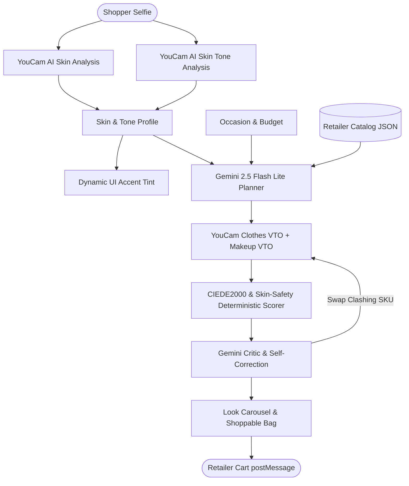

# LOOKSMITH — AI Skin-Aware Fashion Stylist & VTO Widget

> **An embeddable, white-label AI fashion stylist widget for fashion retailers.** One selfie in. Skin-aware, shoppable, virtually tried-on looks out.
> Built for the **YouCam API Skin AI & eCommerce VTO Hackathon** (Devpost & Perfect Corp).

---

## 🌟 Key Features

1. **Skin-Aware Makeup & Fabric Selection:**
   - AI Skin Analysis scores (oiliness, pores, moisture, redness, texture) gate makeup finish (velvet-satin vs dewy luminous vs sheer) and recommend breathable barrier fabrics.
2. **Tone-Harmonized Color Palette:**
   - AI Skin Tone Analysis detects skin, eye, brow, lip, and hair colors to form a 6-swatch palette. Garments are matched using **CIEDE2000 ΔE** mathematical color difference.
   - Dynamic accent: The UI accent (`--accent`) dynamically tints to the user's flattering palette swatch with a 480ms crossfade.
3. **Autonomous Agent Self-Correction Loop:**
   - Powered by Gemini Flash Lite. When an item clashes with undertones (ΔE > 40), the agent visibly self-corrects: strikes through the clashing piece and swaps in a harmonious piece live in the UI!
4. **Direct Manipulation Look Carousel:**
   - 3 complete looks with swipe, press-and-hold before/after comparison, skin-safe badge sheets, item swap alternatives, and makeup intensity slider.
5. **Taste Memory Vector:**
   - Likes and dislikes update preferences across colors, silhouettes, and price bands. Displays an interactive "Learning: leans earthy, relaxed fit" chip.
6. **White-Label Retailer Console & Drop-in Widget:**
   - Single script embed (`/looksmith.js`) with postMessage protocol (`looksmith:ready`, `looksmith:add-to-bag {skus}`).
   - Includes `demo-store.html` showcasing the widget embedded inside a luxury fashion storefront.

---

## 🏗️ Architecture



---

## ⚡ 60-Second Quickstart

```bash
# 1. Install dependencies
npm install

# 2. Run unit tests (CIEDE2000 math, skin rules, scoring, taste memory)
npm test

# 3. Start development server
npm run dev
```

App runs on `http://localhost:3000`.

- **Standalone Stylist App:** `http://localhost:3000/`
- **Retailer B2B Console:** `http://localhost:3000/?view=console`
- **Fictional Retailer Storefront (Widget Embedded):** `http://localhost:3000/demo-store.html`

---

## 🔑 Environment Variables (`.env`)

```ini
# Gemini API Key (injected automatically in Google AI Studio)
GEMINI_API_KEY="your-gemini-api-key"
GEMINI_MODEL="gemini-2.5-flash"

# YouCam API Key (from Perfect Corp developer portal)
YOUCAM_API_KEY="your-youcam-api-key"

# Demo Mode: 'cached' replays verified responses to conserve unit budget
DEMO_MODE="cached"
```

---

## 🛡️ YouCam APIs Implemented in Pipeline (≥4 APIs)

| API | Endpoint & Code Location | Function in Pipeline |
|---|---|---|
| **1. AI Skin Analysis** | `POST /api/skin` (`server.ts`, `src/utils/skinRules.ts`) | Detects oiliness, pores, moisture, redness to select base finish (matte, dewy, satin) and comfort badge |
| **2. AI Skin Tone Analysis** | `POST /api/tone` (`server.ts`, `src/utils/deltaE.ts`) | Extracts skin/lip/eye hexes, creates 6-color palette, and dynamically tints the UI accent |
| **3. AI Clothes (Cloth) VTO** | `POST /api/tryon/cloth` (`server.ts`) | Synthesizes photorealistic clothing draping on customer selfie |
| **4. AI Makeup VTO** | `POST /api/tryon/makeup` (`server.ts`) | Applies skin-gated makeup pattern with live intensity slider (20%–90%) |

---

## 📦 How to Embed the Widget

Add a single script tag to any retailer website:

```html
<script 
  src="https://your-domain.com/looksmith.js" 
  data-key="pk_meridian_2026" 
  data-theme="meridian"
></script>
```

Listen for cart additions in your host application:

```javascript
window.addEventListener('message', (event) => {
  if (event.data?.type === 'looksmith:add-to-bag') {
    console.log('User added items to cart:', event.data.skus);
    // Add SKUs to Shopify / Magento / custom checkout cart
  }
});
```

---

## 🧪 Unit Testing

Run the Node test runner with `npx --yes tsx --test`:

```bash
npm test
```

Verified tests:
- CIEDE2000 color difference formula precision.
- Skin concern to makeup finish recommendation rules.
- Dynamic AA-contrast accent calculation.
- Retailer catalog filtering and swap alternative matching.
- Deterministic 0–100 look scoring engine.
- Taste memory vector updates on like/dislike interactions.

---

## 📄 License
MIT © 2026 LOOKSMITH Team
