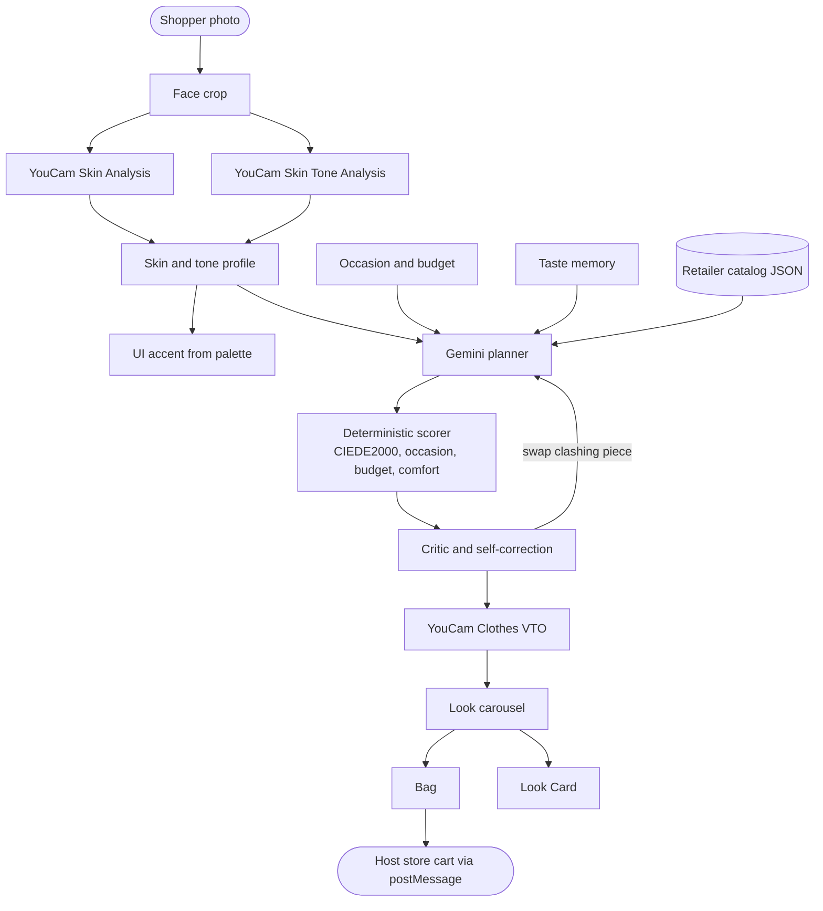

# LOOKSMITH

**An embeddable AI stylist for fashion retailers. One photo in. Skin-aware, shoppable, virtually tried-on looks out.**

Built for the **YouCam API Skin AI & eCommerce VTO Hackathon** (Devpost x Perfect Corp).

| | |
|---|---|
| Demo video | https://youtu.be/cxdtVH4Kwzs |
| Try it | https://looksmith-ai-skin-aware-fashion-stylist-vto.ai.studio |
| License | MIT |

---

## What it is

Most try-on tools answer one question: *how does this item look on me?*
LOOKSMITH answers the one before it: **who is the shopper, what is the occasion, and what should she wear?**

A retailer adds one script tag. A shopper gives one photo. YouCam Skin Analysis and Skin Tone Analysis read her face and build a personal colour palette. She states an occasion and a budget. An agent plans complete looks from the store's own catalog. YouCam Clothes Virtual Try-On renders each look on her photo. She buys a single piece or the whole look, and the chosen SKUs go straight to the store's cart.

**Retail value:** shoppers get occasion-ready, tone-matched outfits instead of guessing. Retailers get outfit-level suggestions (bigger baskets) and fewer colour and appearance mismatches, behind a white-label widget that themes through tokens.

---

## How it works

1. **Consent.** The shopper agrees to privacy terms before any photo is used.
2. **Capture.** One photo. The app crops the face.
3. **Skin and tone (YouCam).** Skin Analysis and Skin Tone Analysis run in parallel on the cropped face.
4. **Palette.** Skin, eye, brow, lip and hair colours become a six-swatch personal palette. The interface accent takes on her palette.
5. **Occasion and budget.** Free text plus a budget.
6. **Agent.** Gemini plans candidate looks from the retailer catalog. A deterministic scorer rates each look. A critic can swap a piece that clashes with her tone.
7. **Try-on (YouCam).** Clothes Virtual Try-On renders each look on her photo.
8. **Browse.** Swipe looks, press and hold to compare with the original photo, open the skin-comfort sheet, swap items.
9. **Taste memory.** Likes, dislikes and swaps feed the next planning round.
10. **Bag and share.** Add a single piece or the full look. Export a Look Card. SKUs pass to the host store through `postMessage`.

---

## YouCam APIs used

| # | YouCam API | Server route | What it does in the product |
|---|---|---|---|
| 1 | **AI Skin Analysis** | `POST /api/skin` | Cosmetic skin signals (oiliness, pores, moisture, redness, texture). They drive text-based finish advice and comfort notes. |
| 2 | **AI Skin Tone Analysis** | `POST /api/tone` | Skin, eye, brow, lip and hair colours. They build the six-swatch palette and the UI accent. |
| 3 | **AI Clothes Virtual Try-On, full body** | `POST /api/tryon/cloth` | Renders dresses and ensembles on the shopper's photo. |
| 4 | **AI Clothes Virtual Try-On, upper body** | `POST /api/tryon/cloth` | Renders tops, jackets and layered pieces on the shopper's photo. |

YouCam calls are asynchronous. The server creates a task, polls until it finishes, and caches results by SHA-256 of image plus parameters. Client code in `src/services/youcamClient.ts`.

### Live call proof

Task IDs from the recorded live run (copy from `artifacts/pipeline_report.json`):

| API | Task ID | Live or cached |
|---|---|---|
| Skin Analysis | `DobumNKvpfyUoIzJzaHW59nLFkS5Dp7G0N_hqhs3Js8d8NgNLmC1VJlEDwhlA_N4SpcgV8WTLEnG8Q2PXjtLzQ` | |
| Skin Tone Analysis | `0ewAjaKiRlOdKiLx_raeu8umqSaH7ao1gp1zQAQJQMxAJ2LSO-Gcxeh5Ho3D_qBjaWDS9eILM6KP1umZGeEfHw` | |
| Clothes VTO (full body) | `Tav04_834lMjBTS2SrYP1LfLGMzS3_yNDuNlhOuFflkrr9rVRynG9Aa-QaPrVJYl` | |
| Clothes VTO (upper body) | `axcGlfG7g0c-e11evjIysCi_ukCodYb2eA0sPxdXMfCo2cJNWMlFb2rEk2Mi63cw` | |

### Roadmap, not in this submission

**AI Makeup Virtual Try-On.** Skin results already choose a recommended finish (for example matte, satin or dewy). Today that advice is shown as text, with an intensity control for the recommendation. Rendering it on the face with YouCam Makeup VTO is the next step.
More YouCam categories (shoes, bags, jewellery, hair) are also planned.

---

## Architecture



**Stack:** React, TypeScript, Vite, Tailwind CSS. Node and Express backend. Server-Sent Events stream agent progress. Gemini through the Google GenAI SDK.

**Key files**

| Path | Role |
|---|---|
| `server.ts` | API routes, YouCam proxy, SSE stream, widget bundle |
| `src/services/youcamClient.ts` | YouCam task creation, polling, caching |
| `src/agent/agentLoop.ts` | Planner, critic, copywriter, fallback planner |
| `src/utils/scoring.ts` | Deterministic look scorer |
| `src/utils/deltaE.ts` | CIEDE2000 colour distance |
| `src/utils/skinRules.ts` | Skin signal to finish advice, accent contrast |
| `src/utils/tasteMemory.ts` | Taste vector and planner prompt serialisation |
| `seed/catalog.json` | Fictional retailer catalog |
| `public/demo-store.html` | Fictional storefront that embeds the widget |

---

## Features

- **Tone-matched palette.** Garment colours are compared with the shopper's palette using CIEDE2000.
- **Dynamic accent.** The interface retints to a flattering swatch, with an AA contrast check.
- **Skin-aware advice.** Skin signals pick a recommended finish and add a comfort note to each look. Text only. Cosmetic guidance, not medical advice.
- **Visible agent.** The Agent Stage streams plan, try-on and critic steps. If the critic swaps a clashing piece, the swap is shown.
- **Fallback planner.** If Gemini fails or times out, a rule-based planner returns looks. The app does not dead-end.
- **Taste memory.** Likes, dislikes and swaps shift colour, silhouette and brand priors. They are sent to the planner on the next run. Stored in the browser, clearable in Settings.
- **Look carousel.** Swipe, press and hold for before and after, swap items, skin-comfort sheet.
- **Buy a piece or the look.** Budget guides ranking. Shoppers can add one hero piece or the full ensemble.
- **Share Look Card.** Canvas PNG export or native share. Raw skin scores are hidden by default.
- **Under the Hood panel.** Live API calls, task IDs, unit counter, taste memory state.
- **Retailer Console and widget.** Theme tokens, embed snippet, `postMessage` bridge, demo storefront.
- **Dark mode, reduced-motion-friendly design tokens, keyboard-accessible controls.** See known limitations for gaps.

---

## Quickstart

```bash
npm install
cp .env.example .env     # add your keys
npm test
npm run dev
```

Open:

- Stylist app: `http://localhost:3000/`
- Retailer Console: `http://localhost:3000/?view=console`
- Fictional storefront with widget: `http://localhost:3000/demo-store.html`

### Environment variables

```ini
GEMINI_API_KEY="your-gemini-api-key"
GEMINI_MODEL="gemini-2.5-flash"      # set the model you want to use
YOUCAM_API_KEY="your-youcam-api-key"
DEMO_MODE="cached"                    # cached | live
```

### Demo modes

| Mode | Behaviour |
|---|---|
| `live` | Every call goes to YouCam and Gemini. Uses your YouCam units. |
| `cached` | Replays results saved from real runs, keyed by image hash. Spends no units. Use this to try the app without a key. Calls with a new input fall back to live when a key is set. |

The hosted trial link may run in `cached` mode to protect the unit budget. The recorded video shows live calls.

### Unit thrift

Results are cached by SHA-256 of image plus parameters. Calls are capped per session. Independent calls (skin and tone) run in parallel.

---

## Embed the widget

```html
<script
  src="https://YOUR-DOMAIN/looksmith.js"
  data-key="YOUR_PUBLIC_RETAILER_KEY"
  data-theme="meridian"
></script>
```

Listen on the host page:

```javascript
window.addEventListener('message', (event) => {
  if (event.data?.type === 'looksmith:add-to-bag') {
    // event.data.skus is the array of chosen SKUs
    addToCart(event.data.skus);
  }
});
```

Events: `looksmith:ready`, `looksmith:add-to-bag`, `looksmith:close`.

Theming is token-based (accent, display font, radius scale, logo slot). Two fictional retailers are included: **Meridian Mart** (marketplace) and **Northloom Denim Co.** (single brand).

---

## Testing

```bash
npm test
```

Covers CIEDE2000 distance, palette harmony, skin-to-finish rules, accent contrast, catalog filtering, look scoring, taste memory updates, and the agent loop with the fallback planner.

---

## Privacy and safety

- Explicit consent before any photo is used.
- Photos stay in memory for the session. They are not written to disk or a database. "Delete my data" in Settings clears session state.
- Taste preferences are stored in the browser (`localStorage`) and can be cleared in Settings.
- No age, gender, ethnicity or health inference is shown.
- Skin output is **cosmetic guidance for wardrobe and style only. It is not medical advice.**
- API keys stay on the server. They are never sent to the client.
- All brands and catalog items in the demo are fictional.

---

## Known limitations

- **Budget is guidance, not a hard cap.** It shapes ranking and suggestions. A look can land above the typed budget. Shoppers can buy single pieces to stay within it.
- **Pose comes from the input photo.** Virtual try-on drapes garments on the shopper's photo, so every look keeps her pose.
- **Makeup try-on is not implemented.** Finish advice is text only.
- **Taste memory is client-side.** It is passed to the planner on each run but not stored on the server.
- **Accessibility work remains.** Focus rings and some tap targets need polish. `prefers-reduced-motion` support is partial.
- **Catalog is small and fictional.** Real retailers would connect a feed through the catalog adapter.

---

## Roadmap

1. YouCam Makeup Virtual Try-On, using the skin-based finish already computed.
2. Shoes, bags, jewellery and hair try-on.
3. Server-side taste profiles and retailer analytics.
4. Catalog connectors for common commerce platforms.
5. Hard budget caps with automatic cheaper swaps.

---

## Credits

- **YouCam API** by Perfect Corp: Skin Analysis, Skin Tone Analysis, Clothes Virtual Try-On.
- **Gemini** by Google for planning and rationale text.
## License

MIT. See `LICENSE`.
